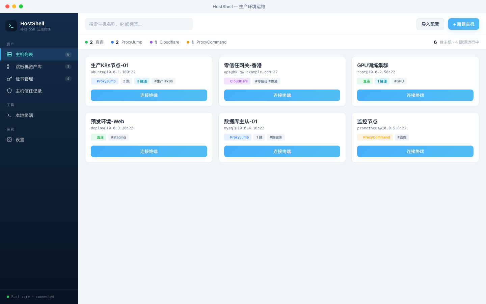
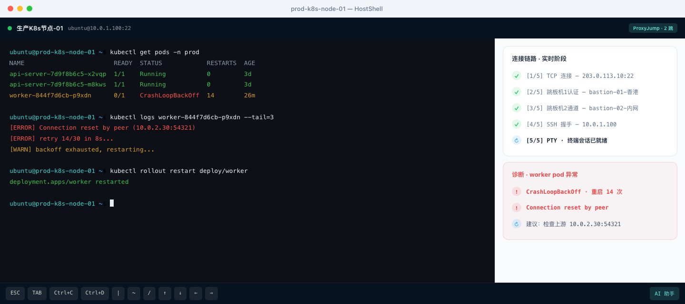
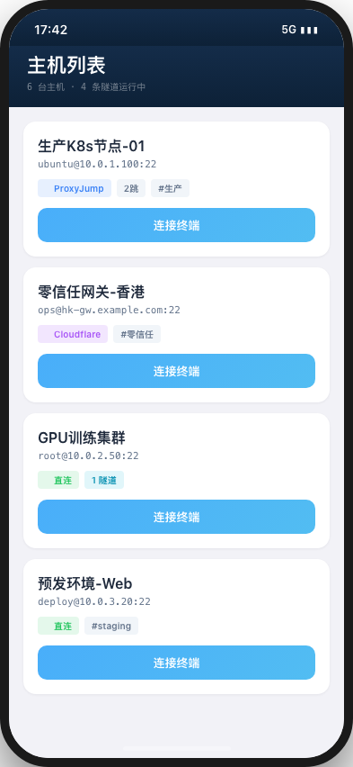
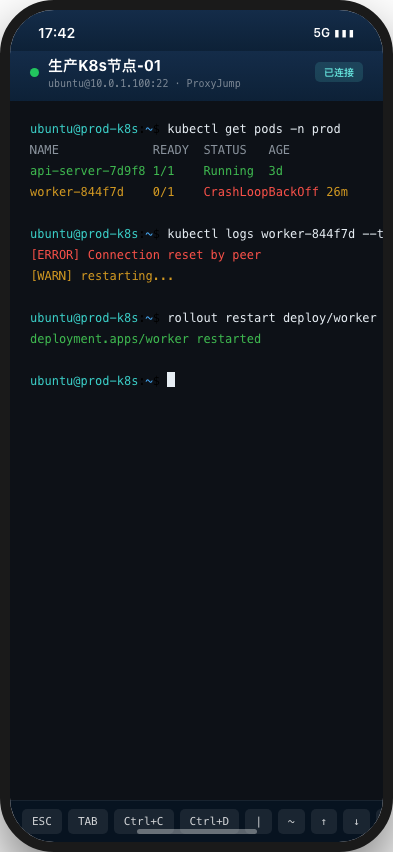

<div align="center">


# HostShell

**凌晨 3 点的告警，不用再爬起来开电脑。**

用手机直连、跳板机多跳、Cloudflare 零信任 —— 一切如常。

[](https://twitter.com/intent/follow?screen_name=hostshell)
[](https://github.com/kbsonlong/hostshell/releases)
[](https://github.com/kbsonlong/hostshell/actions)
[](#license)


[下载最新版](https://github.com/kbsonlong/hostshell/releases) · [快速开始](#-快速开始) · [加入讨论](https://github.com/kbsonlong/hostshell/discussions)



</div>

---

## ✨ 为什么是 HostShell

> 手机上也能**原生**跑 ProxyJump 和 Cloudflare Access —— 市面上大多数移动 SSH 客户端做不到这一点。

| 你遇到的 | HostShell 给你的 |
|---|---|
| 堡垒机配置复杂，手机上基本没法用 | 🪜 **ProxyJump 多跳**可视化配置，逐跳状态实时可见 |
| Cloudflare 零信任环境手机无法直连 | 🛡 **原生 WSS 通道**封装 `cloudflared access`，Service Token 免浏览器 |
| 连接失败只显示 "Connection refused" | 🔍 **分层诊断**：网络 → 网关鉴权 → SSH 认证，失败精确到阶段 |
| 私钥散落各处不安全 | 🔐 私钥 / Token 不出系统安全存储（Keychain），日志自动脱敏 |
| 从 PC 迁移配置要手动重敲 | 📥 解析 `~/.ssh/config`，JumpHost 自动物化，转发规则直接导入 |

**同一颗 Rust 内核**，驱动三种形态：macOS 桌面 App · iOS App · 终端 CLI。

<div align="center">

<p><sub>▲ 连接链路逐阶段上报，故障定位到具体跳数 —— 排障不再靠猜</sub></p>
</div>

## 📱 随身数据中心机房

出差路上、咖啡馆里、电梯中 —— 告警响起时，你离生产环境只差一次点击。

<div align="center">
<table>
<tr>
<td></td>
<td></td>
</tr>
</table>
<p><sub>▲ 左：四种链路模式徽标一目了然 · 右：完整 xterm 终端 + 移动快捷键栏</sub></p>
</div>

## 🚀 快速开始

### CLI — 30 秒连上堡垒机后的机器

```bash
cargo install --path crates/hostshell-cli   # 或 git clone 后 cargo build --release

hostshell-cli import ~/.ssh/config          # 一键迁移现有配置
hostshell-cli connect prod-k8s-node-01      # 直接开连
```

### macOS App

```bash
./scripts/build_macos.sh    # 产出 target/HostShell.app
```

> 或者直接 [下载安装包](https://github.com/kbsonlong/hostshell/releases)（arm64 / amd64 DMG，附 SHA256 校验）。
>
> 首次打开若提示「"HostShell" 已损坏，无法打开」，是 Gatekeeper 对未公证 App 的提示（App 并未损坏），终端执行 `xattr -cr /Applications/HostShell.app` 后即可正常打开。

### iOS App

```bash
./scripts/build_ios.sh      # 构建 XCFramework + 模拟器 App
```

## 🧠 核心能力一览

- **多链路连接** — Direct / ProxyJump（单跳·多跳）/ Cloudflare Access / ProxyCommand
- **连接阶段可视化** — `ConnectionStage` 实时上报每一跳，失败定位到层级
- **完整转发** — `LocalForward` / `RemoteForward` / `DynamicForward`(SOCKS5) / Unix socket
- **内建 ssh-agent** — in-app agent server，RequestKeys/Sign 策略可控
- **ssh-config 导入** — 自动物化 JumpHost 资产，不支持项明确提示而非静默降级
- **Host Key 信任管理** — 指纹核验、变更告警、`forget-known-host` 可复核
- **AI 助手**（可选）— 只读分析终端输出，不发命令、不采集数据

<details>
<summary><b>项目结构</b>（点击展开）</summary>

```
hostshell/
├── crates/
│   ├── hostshell-core/     # Rust 连接内核
│   │   └── src/
│   │       ├── ssh/        # SSH 会话、handler、内建 ssh-agent
│   │       ├── transport/  # direct / bastion / cloudflare / proxy_command / ws_adapter
│   │       ├── storage/    # 配置存储、ssh-config 导入、密钥管理
│   │       ├── model/      # Host / JumpHost / KnownHost / ConnectionStage
│   │       └── ffi/        # Swift FFI（C ABI）
│   └── hostshell-cli/      # 终端 CLI
├── apps/
│   ├── macos/              # macOS SwiftUI 客户端
│   └── ios/                # iOS SwiftUI 客户端
└── scripts/                # 构建 / 回归脚本
```

</details>

<details>
<summary><b>开发者命令参考</b>（点击展开）</summary>

```bash
# 基本用法
./target/release/hostshell-cli list                    # 列出已配置主机
./target/release/hostshell-cli add myserver \
    --host 10.0.0.1 --user ubuntu --port 22 \
    --identity-file ~/.ssh/id_ed25519 \
    --jump bastion                                     # 经堡垒机多跳
RUST_LOG=info ./target/release/hostshell-cli connect myserver   # 调试

# 测试与回归
cargo test -p hostshell-core
./scripts/check_regression.sh                          # 跨客户端回归基线
```

主机密钥信任记录可通过 `hostshell-cli list-known-hosts` 查看，`forget-known-host <主机名> <端口>` 删除前请先核对指纹。

Release（IPA + macOS DMG）：GitHub Actions → **Manual Release Build** → 在 `version` 中填版本号（如 `v0.1.0`）触发。回归通过后自动产出双架构 DMG / .app zip / CLI tar 包 / 未签名 IPA，并创建带 SHA256SUMS 的 GitHub Release。仅留空 `version` 则只构建 Artifacts（保留 14 天）不发布。macOS 产物未签名公证，iOS IPA 未签名（供 Sideloadly / AltStore / Sideloop / Xcode 侧载重签），正式分发需自行配置 Apple 签名。

</details>

## ⭐ 支持项目

如果 HostShell 帮你在凌晨省下了一次开机，考虑给它一个 Star —— 这是对独立开发最大的鼓励。

<div align="center">

**[⭐ Star](https://github.com/kbsonlong/hostshell/stargazers) · [🐛 提 Issue](https://github.com/kbsonlong/hostshell/issues) · [💬 加入讨论](https://github.com/kbsonlong/hostshell/discussions) · [𝕏 关注 @hostshell](https://twitter.com/intent/follow?screen_name=hostshell)**

</div>

## 🗺 路线图

- [x] 直连 / ProxyJump 多跳 / Cloudflare Access / ProxyCommand
- [x] SSH 隧道与 Unix socket 转发
- [x] 内建 ssh-agent、ssh-config 导入
- [ ] Web SSO 登录（Cloudflare IdP WebView）
- [ ] 生物识别应用锁
- [ ] SFTP 文件管理

完整规划见 [`docs/roadmap.md`](docs/roadmap.md)。

## 📚 文档

- [`docs/development-guide.md`](docs/development-guide.md) — 三端构建与回归验证指南
- [`prd.md`](prd.md) — 产品需求文档
- [`mobile_ssh_proxy_design.md`](mobile_ssh_proxy_design.md) — 移动端代理链路技术设计
- [`REGRESSION.md`](REGRESSION.md) — 回归测试基线

## 环境要求

- Rust stable（edition 2021，依赖 `russh 0.65` / `tokio`）
- macOS 13+ / iOS 16+
- Swift 工具链（SwiftPM）

---

<div align="center">
<sub>Built with 🦀 Rust + ☁️ SwiftUI · HostShell — your datacenter, in your pocket.</sub>
</div>
